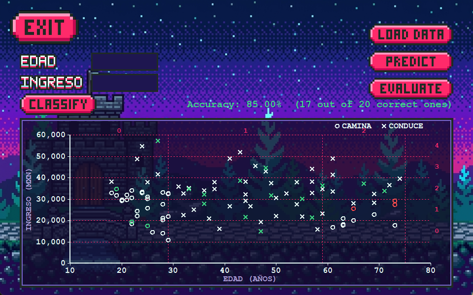

# The Mac Toolkit

Aplicación de escritorio en Python que reúne tres proyectos: **Bayesian**, **Graphs** y **Semaphores**. Cada proyecto se abre desde un menú tipo inventario de juego.

El primer proyecto implementado, **Bayesian Classifier**, predice si una persona **camina** o **conduce** según su edad y su ingreso, usando un clasificador bayesiano implementado desde cero.


## Características

- Pantalla de inicio con avatares animados: entran caminando, cambian de pose con el mouse, al hacer click y al presionar START.
- Menú de proyectos con casillas de inventario e íconos pixel art.
- **Proyecto Bayesian:**
  - Carga del dataset y entrenamiento del modelo (**LOAD DATA**).
  - Predicción del conjunto de prueba (**PREDICT**).
  - Evaluación con matriz de confusión y precisión general (**EVALUATE**).
  - Clasificación de una persona escribiendo su edad e ingreso (**CLASSIFY**).
  - Gráfica de dispersión con los límites de los rangos (*bins*).
- Ejecutable para Windows que no requiere instalar Python.

## Capturas

| Proyectos | Bayesian |
|---|---|
|  |  |

## Clasificador bayesiano

El modelo usa dos características discretizadas en rangos:

| Edad (años) | Bin | Ingreso (MXN) | Bin |
|---|---|---|---|
| 17 – 29 | 0 | 9,999 – 19,999 | 0 |
| 30 – 59 | 1 | 20,000 – 29,999 | 1 |
| 60 – 75 | 2 | 30,000 – 39,999 | 2 |
| | | 40,000 – 49,999 | 3 |
| | | 50,000 – 60,000 | 4 |

Con estos rangos calcula:

- **Probabilidad a priori:** P(C)
- **Probabilidad conjunta** con suavizado de Laplace: P(edad, ingreso | C)
- **Probabilidad posterior:** P(C | edad, ingreso) = P(edad, ingreso | C) · P(C) / P(edad, ingreso)

La clase predicha es la de mayor probabilidad posterior.

**Dataset:** 100 registros (`bayesian/data/dataset_walk_drive_publicado.csv`), divididos en 80 de entrenamiento y 20 de prueba.

**Resultado:** precisión general de **85%** (17 de 20) sobre el conjunto de prueba.

|  | Pred. Camina | Pred. Conduce |
|---|---|---|
| **Real Camina** | 3 | 0 |
| **Real Conduce** | 3 | 14 |

## Uso

### Opción 1: ejecutable (Windows)

1. Descarga `MacToolkit.exe`.
2. Haz doble click. La primera pantalla tarda unos segundos en aparecer.
3. Si Windows muestra "Windows protegió su PC", da click en **Más información → Ejecutar de todas formas**.

### Opción 2: desde el código

Requisitos: Python 3.12.

```bash
pip install pillow pandas numpy
python main.py
```

## Estructura del proyecto

```
the-mac-toolkit/
|-- main.py              ventana, navegación y loop de animación
|-- ui.py                carga de imágenes, botones y utilidades
|-- chart.py             gráfica de dispersión
|-- avatar.py            avatar animado
|-- avatars_config.py    configuración de los avatares
|-- pages/               una página por proyecto
|-- bayesian/            preprocesamiento, clasificador y evaluador
|   `-- data/            dataset CSV
|-- images/              fondos, botones, avatares, íconos
|-- Colab-Notebooks/     notebook del clasificador
`-- docs/                capturas y documentación
```

## Estado

| Proyecto | Estado |
|---|---|
| Bayesian | Terminado |
| Graphs | En desarrollo |
| Semaphores | En desarrollo |

## Autores

- Sandra Marlene Cobian Aquino
- Guillermo Christopher Mendieta Arreola
